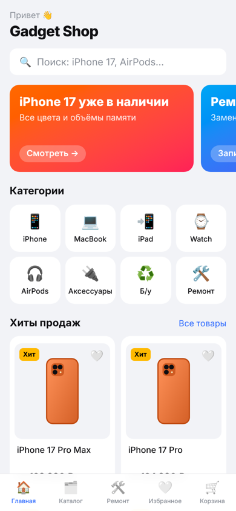
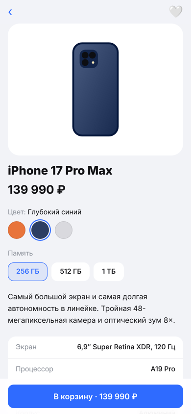
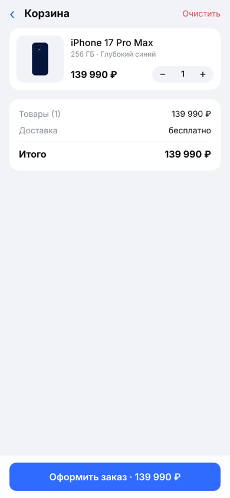
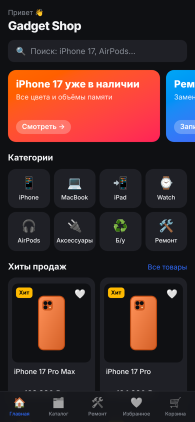
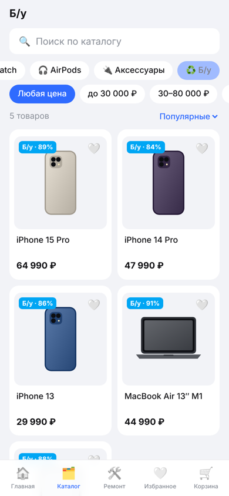
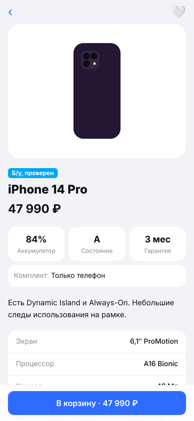
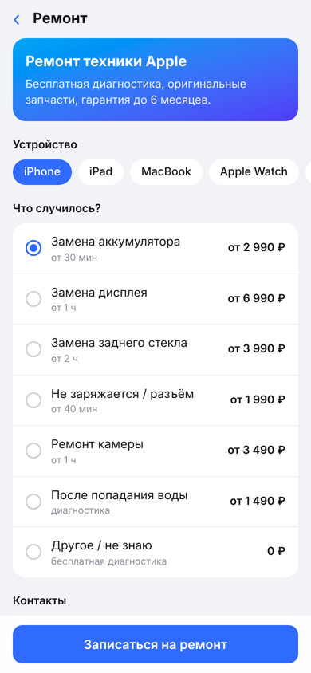
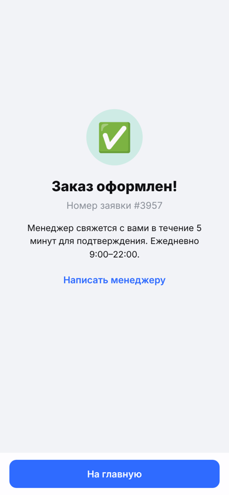

# Gadget Shop: Telegram Mini App магазина техники

Мини-приложение для Telegram: витрина магазина техники Apple с каталогом, корзиной, оформлением заказа и записью на ремонт. Заказы приходят менеджеру сообщением от бота.

Портфолио-проект. Идея: у многих небольших магазинов техники в Telegram нет каталога и цен, всё «пишите в личку». Мини-апп превращает канал в полноценный магазин, не выходя из Telegram.

<p>
  
  
  
  
</p>
<p>
  
  
  
  
</p>

## Возможности

- **Каталог**: категории (iPhone, MacBook, iPad, Watch, AirPods, аксессуары, б/у), поиск, фильтр по цене, сортировка
- **Карточка товара**: выбор цвета (картинка перекрашивается) и памяти с пересчётом цены, характеристики
- **Б/у устройства**: состояние аккумулятора, класс, комплект, гарантия
- **Корзина и оформление**: самовывоз или курьер, данные из профиля Telegram подставляются автоматически
- **Запись на ремонт**: выбор устройства и услуги с ценами «от»
- **Избранное**, бейджи «Хит / Новинка / Скидка», баннеры на главной
- **Нативный вид Telegram**: цвета темы (светлая и тёмная), MainButton, BackButton, вибро-отклик
- **Бот**: присылает менеджеру заказ с составом и контактами, отвечает покупателю, кнопка «Открыть магазин» на /start
- **Безопасность**: сервер проверяет подпись `initData` от Telegram, поэтому заказ нельзя подделать из браузера

Вне Telegram приложение работает в демо-режиме: можно пройти весь сценарий по прямой ссылке, но заказ никуда не отправляется.

## Стек

- React 19, TypeScript, Vite, Tailwind CSS 4, Zustand (корзина и избранное сохраняются)
- Telegram Web Apps API (`telegram-web-app.js`)
- Vercel: статический фронтенд и serverless-функции `api/order` (приём заказов) и `api/bot` (вебхук бота)
- Без базы данных: каталог лежит в `src/data/products.ts`

## Структура

```
api/
  order.ts          приём заказа или заявки, проверка initData, отправка менеджеру
  bot.ts            вебхук бота (/start с кнопкой мини-аппа)
  _lib/telegram.ts  проверка подписи и вызовы Bot API
src/
  data/products.ts  каталог и прайс ремонта
  lib/              Telegram-обёртка, состояние, API
  components/       карточки, кнопки, иллюстрации устройств
  screens/          экраны приложения
scripts/set-webhook.mjs  настройка бота после деплоя
```

## Запуск локально

```bash
npm install
npm run dev
```

Откройте http://localhost:5173. Приложение запустится в демо-режиме.

## Деплой

1. Импортируйте репозиторий в [Vercel](https://vercel.com/new). Настройки сборки Vite определятся автоматически.
2. В **Settings → Environment Variables** добавьте:
   - `BOT_TOKEN` — токен бота от @BotFather
   - `ADMIN_CHAT_ID` — ваш Telegram ID (узнать можно у @userinfobot) или ID группы менеджеров
   - `WEBAPP_URL` — адрес сайта на Vercel, например `https://gadget-shop.vercel.app`
   - `WEBHOOK_SECRET` — любая случайная строка (необязательно)
3. Сделайте Redeploy, чтобы переменные применились.
4. Подключите бота: `BOT_TOKEN=... WEBAPP_URL=... WEBHOOK_SECRET=... npm run set-webhook`. Скрипт настроит вебхук, кнопку меню «Магазин» и описание бота.

## Как адаптировать под свой магазин

- Товары и цены: `src/data/products.ts`
- Название, контакт менеджера, часы работы: `src/lib/config.ts`
- Вместо векторных иллюстраций можно подставить фото товаров

Цены и товары в демо-каталоге ориентировочные. Проект не связан с Apple.
