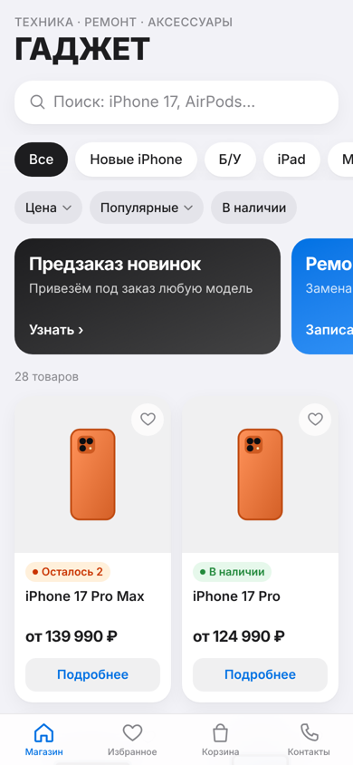
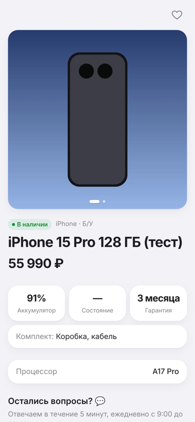
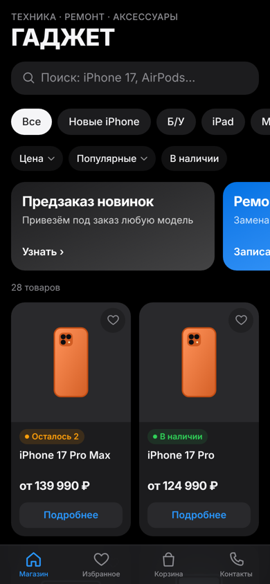
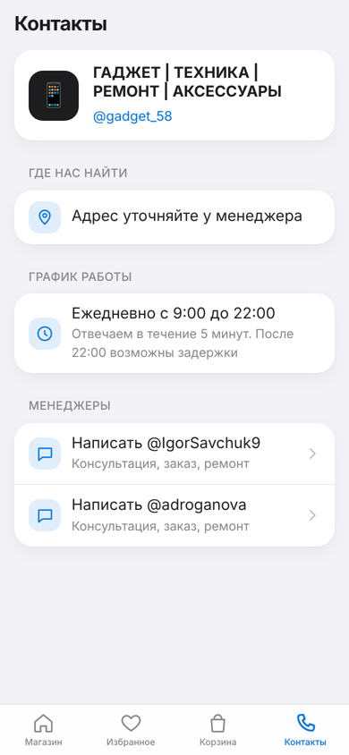
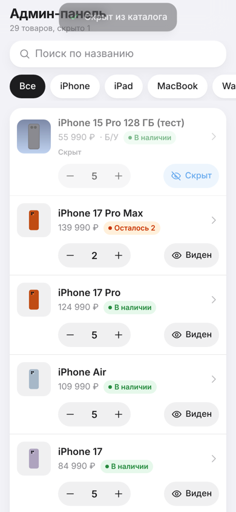
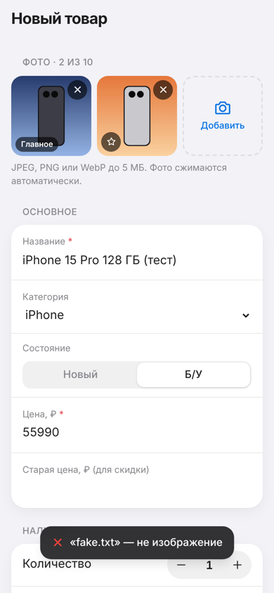

# ГАДЖЕТ | ТЕХНИКА | РЕМОНТ | АКСЕССУАРЫ: Telegram Mini App

Мини-приложение магазина техники внутри Telegram: каталог с фото и наличием, корзина, запись на ремонт, связь с менеджерами и админ-панель, в которой владелец сам ведёт товары с телефона.

**Демо:** бот [@Gadgetshop_robot](https://t.me/Gadgetshop_robot) (кнопка «Магазин») или сайт [gadget-shop-miniapp.netlify.app](https://gadget-shop-miniapp.netlify.app) в браузере.

<p>
  
  
  
  
</p>
<p>
  
  
  
  
</p>

## Возможности

**Покупателю**
- Каталог: поиск, чипсы категорий (Новые iPhone, Б/У, iPad, MacBook, Watch, AirPods, Аксессуары, Ремонт), фильтр по цене, «только в наличии», сортировка
- Карточки с фото и статусом: «В наличии», «Осталось N», «Нет в наличии», «Под заказ»
- Страница товара: галерея со свайпом, выбор цвета и памяти, характеристики, состояние б/у (аккумулятор, внешний вид, комплект)
- «Написать менеджеру»: две кнопки, чат открывается с готовым текстом «Здравствуйте! Интересует: …, цена»
- Корзина и оформление заказа, запись на ремонт: заявки приходят менеджеру от бота
- Контакты: адрес с маршрутом, график, менеджеры, отзывы
- Нативный вид Telegram: тема (светлая/тёмная) из `themeParams`, MainButton, BackButton, вибро-отклик, safe-area

**Владельцу (админ-панель)**
- Вход только для Telegram ID из списка админов, проверка на сервере
- Добавление, редактирование и удаление товаров (с подтверждением)
- Количество кнопками «+ / −» или вводом числа прямо в списке; при 0 статус сам становится «Нет в наличии»
- Фото: несколько штук, сжатие в WebP до 1200px прямо на телефоне, выбор главного, удаление
- «Скрыть / показать в каталоге», поиск и фильтры внутри админки

## Как устроено

- **Фронтенд:** React 19, TypeScript, Vite, Tailwind CSS 4, Zustand
- **Бэкенд:** одна функция Netlify (`netlify/functions/api.ts`) обслуживает все `/api/*`
- **Хранилище:** Netlify Blobs. Каталог хранится одним JSON-документом, фото отдельными файлами. Это встроенное хранилище Netlify: не нужна отдельная база данных, аккаунт или ключи. При первом запуске сервер сам переносит стартовый каталог из `shared/seed.ts`
- **Безопасность:** каждый админский запрос несёт `initData` из Telegram; сервер проверяет HMAC-подпись токеном бота и сверяет `user.id` со списком `ADMIN_IDS`. Одновременные правки двух админов не затирают друг друга (условная запись по ETag)

```
server/
  router.ts            маршруты /api/*
  auth.ts              проверка админа
  telegram.ts          проверка initData, вызовы Bot API
  storage.ts           Netlify Blobs: каталог и фото
  handlers/            products, photos, admin, order, bot
shared/
  catalog.ts           модель товара, статусы наличия, валидация
  seed.ts              стартовый каталог
src/
  screens/             экраны магазина и admin/
  components/          карточки, галерея, кнопки, иконки
  lib/                 Telegram-обёртка, API, состояние, сжатие фото
shop.config.json       адрес, отзывы, менеджеры, график
```

## Данные магазина

Адрес, ссылка на отзывы, менеджеры и график лежат в `shop.config.json`. Поменяйте значения и сделайте `git push`, сайт пересоберётся сам. Пустой адрес или пустая ссылка на отзывы просто скрывают кнопки «Построить маршрут» и «Отзывы».

## Переменные окружения

| Переменная | Что это |
| --- | --- |
| `BOT_TOKEN` | токен бота от @BotFather |
| `ADMIN_CHAT_ID` | куда бот присылает заказы (ваш Telegram ID или ID группы) |
| `ADMIN_IDS` | Telegram ID админов через запятую. Если пусто, админ — владелец из `ADMIN_CHAT_ID` |
| `WEBAPP_URL` | адрес сайта, например `https://gadget-shop-miniapp.netlify.app` |
| `WEBHOOK_SECRET` | случайная строка для защиты вебхука (необязательно) |

На Netlify: Project configuration → Environment variables, затем Deploys → Trigger deploy.

## Запуск локально

```bash
npm install
cp .env.example .env.local   # заполните BOT_TOKEN и ADMIN_IDS
npm run dev
```

`npm run dev` поднимает и фронтенд, и API, а вместо Netlify Blobs использует локальный эмулятор (данные в `.netlify/blobs-local`). В обычном браузере приложение работает в демо-режиме; админка открывается только из Telegram, потому что ей нужна подпись `initData`.

## Подключение бота

`BOT_TOKEN=... WEBAPP_URL=... WEBHOOK_SECRET=... npm run set-webhook` настроит вебхук, кнопку меню «Магазин» и описание бота.
